# 📄 Page Controllers — Flow Charts & Architecture

> **Scope:** All 12 JavaScript controller files inside `phase01/js/pages/`  
> Each page controller follows a common init → load data → render UI pattern with API + LocalStorage fallback.

---

## 📑 Table of Contents

- [Common Architecture Pattern](#-common-architecture-pattern)
- [1. dashboard.js — Dashboard Controller](#1-dashboardjs--dashboard-controller)
- [2. addProduct.js — Add / Edit Product Controller](#2-addproductjs--add--edit-product-controller)
- [3. inventory.js — Inventory Catalog Controller](#3-inventoryjs--inventory-catalog-controller)
- [4. sales.js — Record Sale Controller](#4-salesjs--record-sale-controller)
- [5. salesHistory.js — Sales History Ledger Controller](#5-saleshistoryjs--sales-history-ledger-controller)
- [6. forecast.js — Demand Forecast Page Controller](#6-forecastjs--demand-forecast-page-controller)
- [7. reorder.js — Reorder Planning Controller](#7-reorderjs--reorder-planning-controller)
- [8. reports.js — Business Reports Controller](#8-reportsjs--business-reports-controller)
- [9. analytics.js — Advanced Analytics Controller](#9-analyticsjs--advanced-analytics-controller)
- [10. invoices.js — Invoice System Controller](#10-invoicesjs--invoice-system-controller)
- [11. profile.js — User Profile Controller](#11-profilejs--user-profile-controller)
- [12. settings.js — System Settings Controller](#12-settingsjs--system-settings-controller)
- [Shared Dependencies Map](#-shared-dependencies-map)

---

## 🏛 Common Architecture Pattern

Every page controller follows this standard lifecycle:

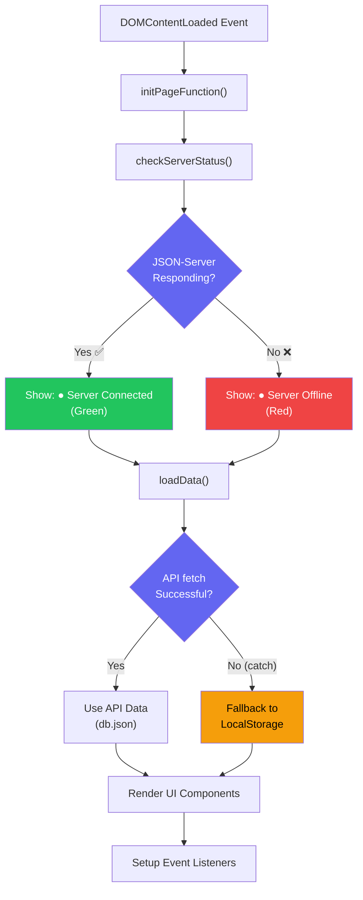

### Common Data Flow Pattern

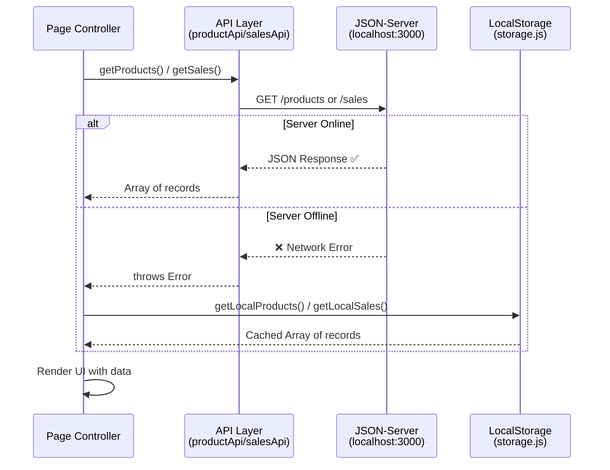

---

## 1. `dashboard.js` — Dashboard Controller

**File:** `js/pages/dashboard.js` (1080 lines)  
**Page:** `dashboard.html`  
**Role:** Main command center — renders 12 KPI cards, 10+ Chart.js visualizations, live clock, and recent sales timeline.

### Initialization Flow

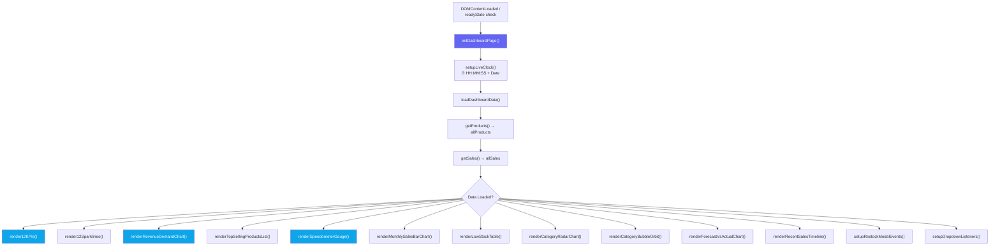

### 12 KPI Cards Calculation Architecture

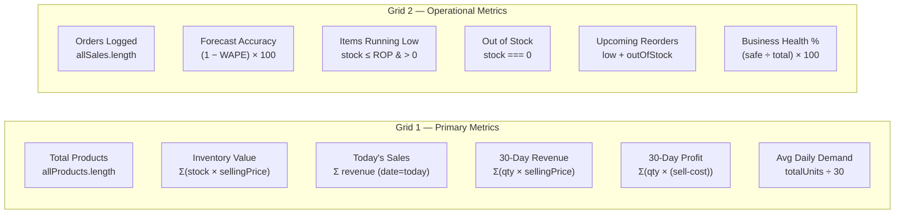

### Chart Rendering Pipeline

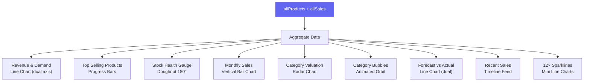

---

## 2. `addProduct.js` — Add / Edit Product Controller

**File:** `js/pages/addProduct.js` (459 lines)  
**Page:** `add-product.html`  
**Role:** Handles both adding new products and editing existing ones via URL param `?id=`.

### Complete Page Flow

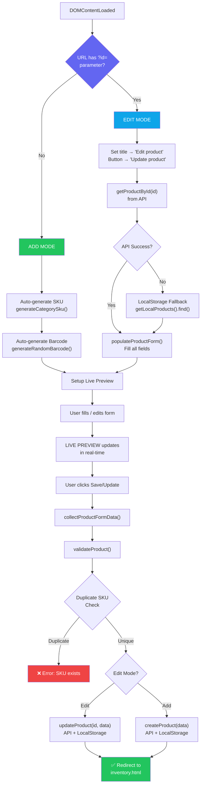

### Live Preview Architecture

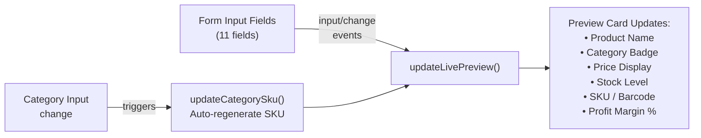

---

## 3. `inventory.js` — Inventory Catalog Controller

**File:** `js/pages/inventory.js` (617 lines)  
**Page:** `inventory.html`  
**Role:** Full product catalog with search, multi-filter, sort, pagination, inline stock update, edit redirect, and delete.

### Page Initialization Flow

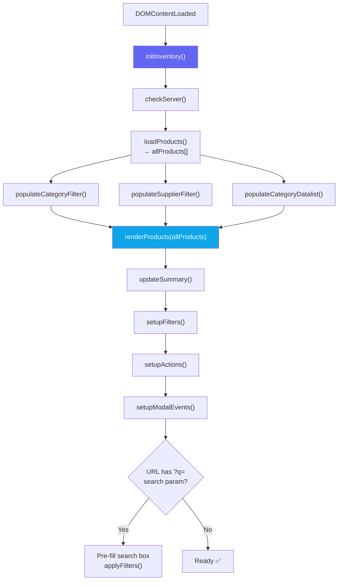

### Filter & Render Pipeline

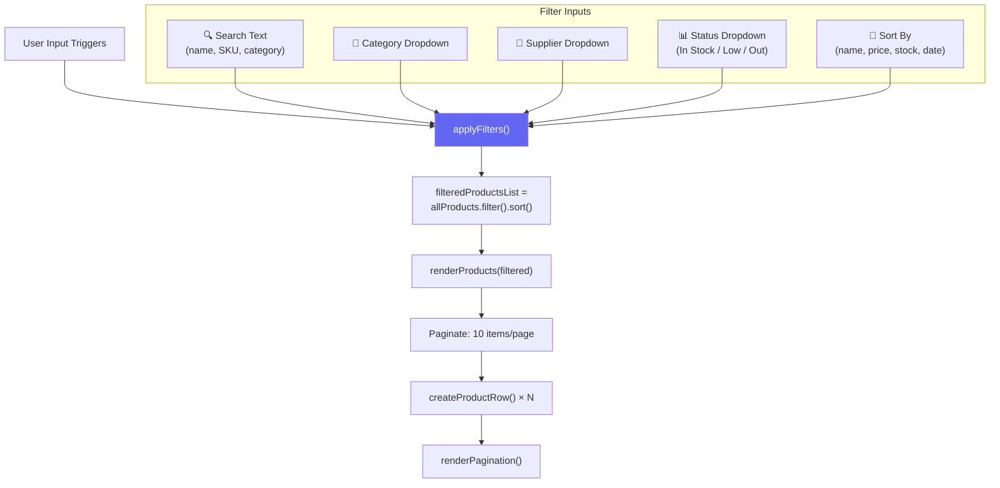

### Product CRUD Actions

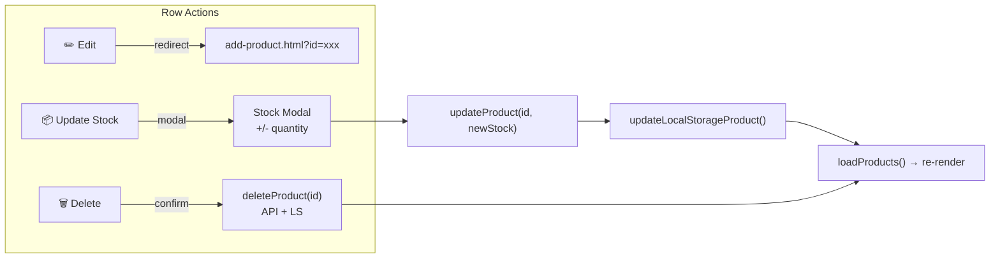

---

## 4. `sales.js` — Record Sale Controller

**File:** `js/pages/sales.js` (441 lines)  
**Page:** `sales.html`  
**Role:** Record a new sale transaction with product selection, live total calculation, stock decrement, and today's performance KPIs.

### Sale Transaction Flow

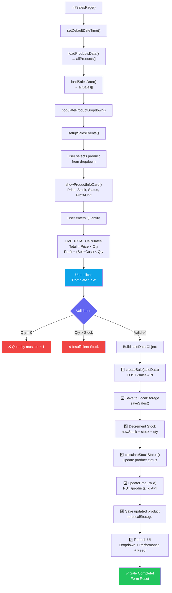

### Data Write Architecture (Dual Persistence)

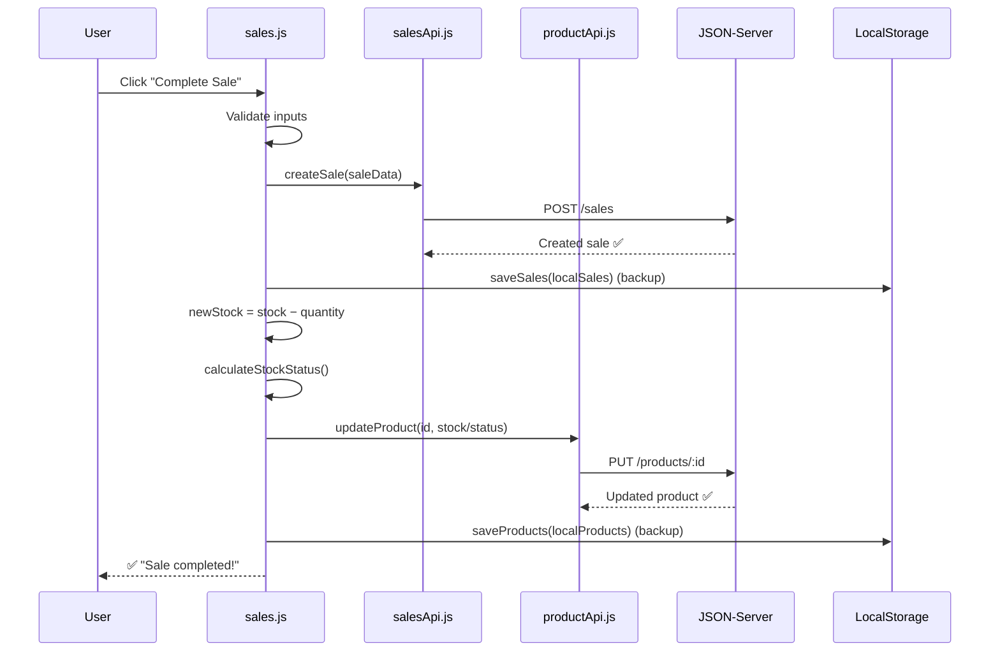

---

## 5. `salesHistory.js` — Sales History Ledger Controller

**File:** `js/pages/salesHistory.js` (534 lines)  
**Page:** `sales-history.html`  
**Role:** Complete sales log with search, product/date filters, pagination (15/page), invoice modal, and CSV export.

### Page Flow

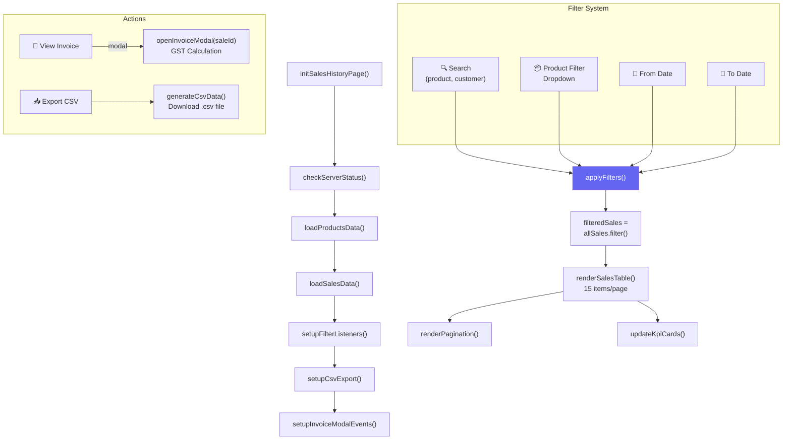

---

## 6. `forecast.js` — Demand Forecast Page Controller

**File:** `js/pages/forecast.js` (468 lines)  
**Page:** `forecast.html`  
**Role:** Runs the Hybrid Forecast Engine on all products, renders 4 KPI cards, forecast chart, top demand products, and product breakdown table.

### Forecast Engine Pipeline

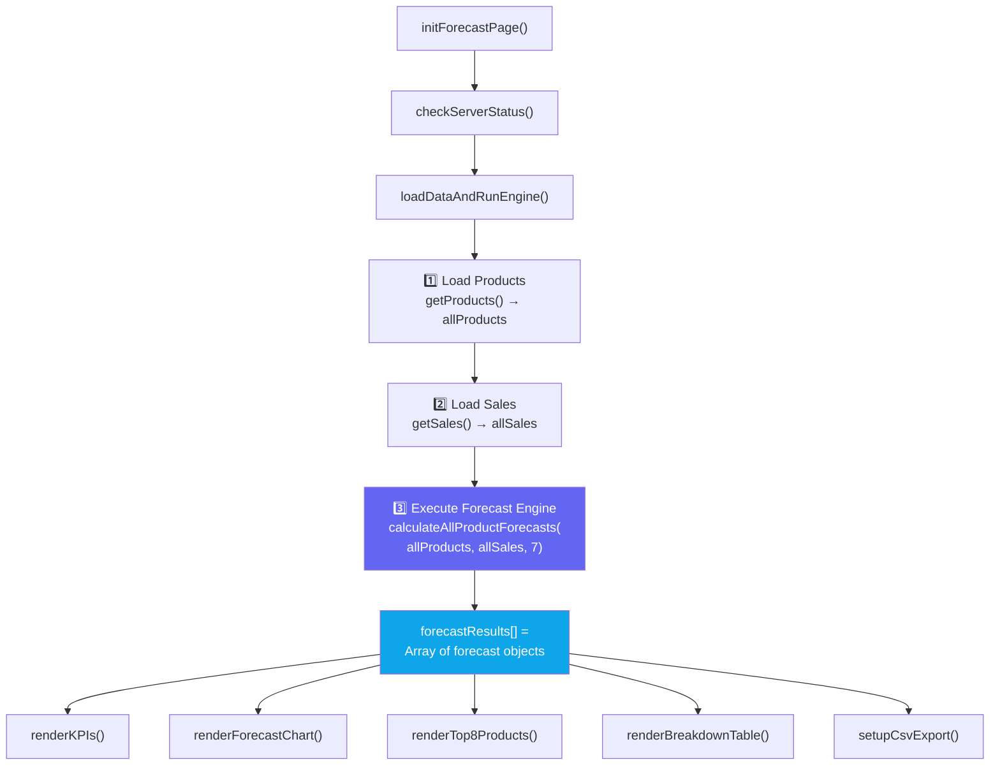

### Forecast KPIs Calculation

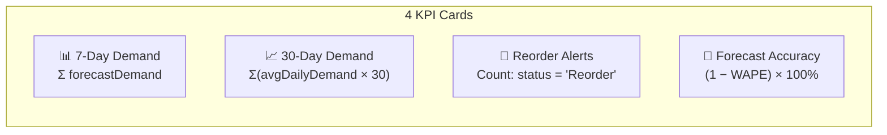

### Per-Product Forecast Result Object

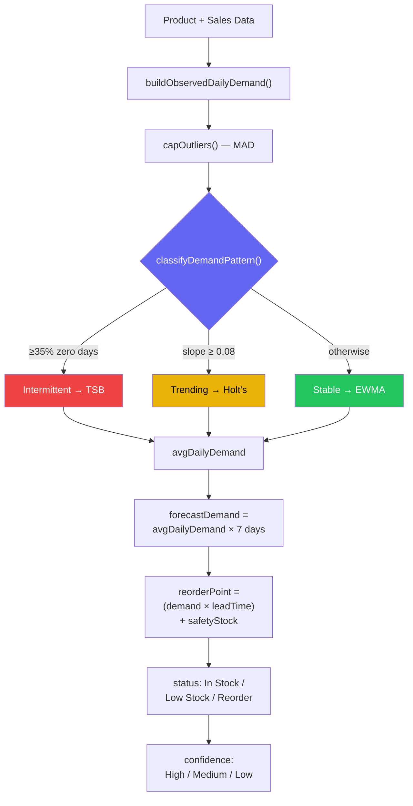

---

## 7. `reorder.js` — Reorder Planning Controller

**File:** `js/pages/reorder.js` (407 lines)  
**Page:** `reorder.html`  
**Role:** Runs forecast engine, shows 4 stock status KPIs, renders reorder table with recommended quantities, and provides interactive restock modal.

### Page Flow

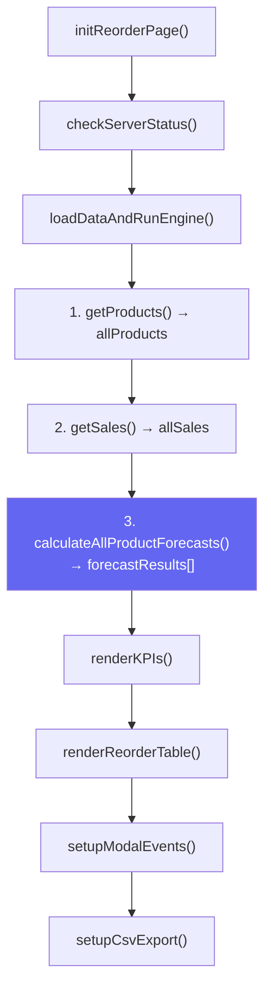

### 4 Stock Status KPIs

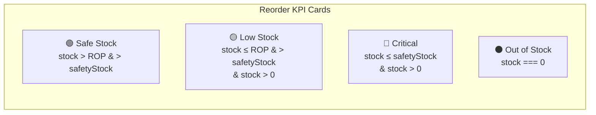

### Restock Modal Flow

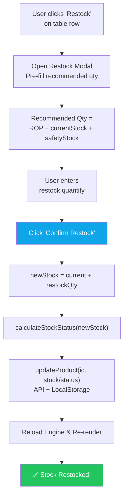

---

## 8. `reports.js` — Business Reports Controller

**File:** `js/pages/reports.js` (551 lines)  
**Page:** `reports.html`  
**Role:** Date-range filtered business performance reports with 5 KPI cards, daily revenue bar chart, category doughnut, monthly breakdown table, top products ranking, and CSV export.

### Initialization & Filter Flow

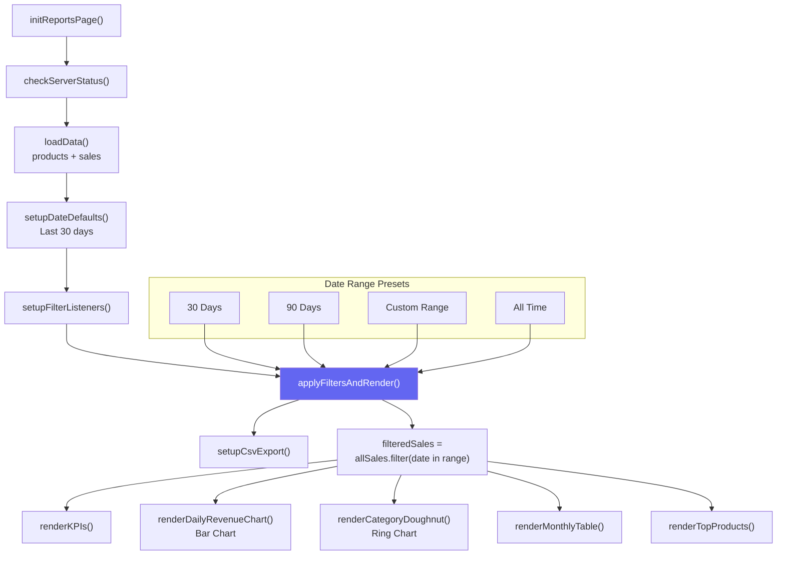

### 5 Report KPIs

```mermaid
flowchart LR
    subgraph "Report KPI Cards"
        K1["💰 Total Revenue<br/>Σ(qty × sellingPrice)"]
        K2["📈 Net Profit<br/>Σ(qty × (sell − cost))"]
        K3["📋 Total Orders<br/>filteredSales.length"]
        K4["📦 Units Sold<br/>Σ quantity"]
        K5["📊 Avg Order Value<br/>Revenue ÷ Orders"]
    end
```

---

## 9. `analytics.js` — Advanced Analytics Controller

**File:** `js/pages/analytics.js` (443 lines)  
**Page:** `analytics.html`  
**Role:** Advanced business analytics — inventory valuation, stock turnover, day-of-week trends, revenue vs orders combo chart, stock health distribution, and top categories ranking.

### Flow

```mermaid
flowchart TD
    A["initAnalyticsPage()"] --> B["checkServerStatus()"]
    B --> C["loadData()<br/>products + sales"]
    C --> D["renderKPIs()"]
    D --> E["renderDayOfWeekChart()<br/>Bar Chart"]
    E --> F["renderRevenueOrdersChart()<br/>Combo: Line + Bar"]
    F --> G["renderStockHealthChart()<br/>Doughnut Ring"]
    G --> H["renderTopCategoriesTable()"]

    style A fill:#6366f1,color:#fff
```

### 4 Analytics KPIs

```mermaid
flowchart LR
    subgraph "Analytics KPI Cards"
        K1["💎 Inventory Valuation<br/>Σ(stock × sellingPrice)"]
        K2["🔄 Stock Turnover<br/>unitsSold ÷ avgInventory"]
        K3["🏆 Top Category<br/>Category with most revenue"]
        K4["📊 Avg Units/Order<br/>totalUnits ÷ totalOrders"]
    end
```

### Chart Architecture

```mermaid
flowchart TD
    A["allSales + allProducts"] --> B["Aggregate by Day-of-Week"]
    A --> C["Aggregate by Month"]
    A --> D["Count by Stock Status"]
    A --> E["Group by Category"]

    B --> F["📊 Sales by Day of Week<br/>Bar Chart (Mon-Sun)"]
    C --> G["📈 Revenue vs Orders<br/>Combo Chart (Line + Bar)"]
    D --> H["🍩 Stock Health Distribution<br/>Doughnut (Safe/Low/Critical/Out)"]
    E --> I["📋 Top Categories Table<br/>Ranked by Revenue"]

    style A fill:#6366f1,color:#fff
```

---

## 10. `invoices.js` — Invoice System Controller

**File:** `js/pages/invoices.js` (401 lines)  
**Page:** `invoices.html`  
**Role:** Invoice list from sales data, interactive invoice preview modal with GST/Tax calculation, print-ready PDF export, search/filter, pagination.

### Flow

```mermaid
flowchart TD
    A["initInvoicesPage()"] --> B["setupLiveClock()"]
    B --> C["loadInvoiceData()<br/>products + sales"]
    C --> D["setupFilters()<br/>search + date"]
    D --> E["setupInvoiceModal()"]
    E --> F["setupCsvExport()"]
    F --> G{"URL has ?saleId=<br/>parameter?"}
    G -->|"Yes"| H["Auto-open invoice<br/>openInvoiceModal(saleId)"]
    G -->|"No"| I["Render Invoice List"]

    style A fill:#6366f1,color:#fff
    style H fill:#0ea5e9,color:#fff
```

### Invoice Modal Architecture

```mermaid
flowchart TD
    A["User clicks 'View Invoice'<br/>on a sale row"] --> B["openInvoiceModal(saleId)"]
    B --> C["Find sale in allSales"]
    C --> D["Find product in allProducts"]
    D --> E["Calculate Invoice Data"]

    subgraph "Invoice Calculation"
        E1["Subtotal = qty × sellingPrice"]
        E2["GST/Tax = Subtotal × taxRate%<br/>(from system_settings)"]
        E3["Grand Total = Subtotal + GST"]
        E4["Profit = qty × (sell − cost)"]
    end

    E --> E1
    E1 --> E2
    E2 --> E3
    E3 --> E4

    E4 --> F["Render Invoice Sheet<br/>in Modal"]
    F --> G["🖨️ Print Invoice<br/>window.print()"]

    style B fill:#6366f1,color:#fff
```

---

## 11. `profile.js` — User Profile Controller

**File:** `js/pages/profile.js` (125 lines)  
**Page:** `profile.html`  
**Role:** View/edit user profile info, change password — all tied to `inventory_current_user` in LocalStorage.

### Flow

```mermaid
flowchart TD
    A["DOMContentLoaded"] --> B["initProfilePage()"]
    B --> C["loadProfileData()"]
    B --> D["setupProfileFormHandler()"]
    B --> E["setupSecurityFormHandler()"]

    C --> F["getCurrentUser()<br/>from LocalStorage"]
    F --> G["Fill Form Fields:<br/>firstName, lastName, email,<br/>phone, organization, designation"]
    G --> H["Update Header:<br/>name, role, email display"]
    H --> I["Show Sales Count:<br/>getLocalSales().length"]
    I --> J["updateGlobalUserUI()"]

    style B fill:#6366f1,color:#fff
```

### Profile Update Flow

```mermaid
flowchart TD
    A["User edits profile fields"] --> B["Click 'Save Changes'"]
    B --> C["Collect form values"]
    C --> D["saveCurrentUser(user)<br/>→ LocalStorage"]
    D --> E["loadProfileData()<br/>Refresh display"]
    E --> F["updateGlobalUserUI()<br/>Update topbar name/avatar"]
    F --> G["✅ Toast: 'Saved!'"]

    style G fill:#22c55e,color:#fff
```

### Password Change Flow

```mermaid
flowchart TD
    A["User enters<br/>Current + New + Confirm"] --> B["Click 'Update Password'"]
    B --> C{"currentPass<br/>empty?"}
    C -->|"Yes"| D["❌ Enter current password"]
    C -->|"No"| E{"newPass ===<br/>confirmPass?"}
    E -->|"No"| F["❌ Passwords don't match"]
    E -->|"Yes"| G["updateUserPassword(<br/>current, new)"]
    G --> H{"Correct current<br/>password?"}
    H -->|"No"| I["❌ Wrong password"]
    H -->|"Yes"| J["✅ Password Updated!"]

    style D fill:#ef4444,color:#fff
    style F fill:#ef4444,color:#fff
    style I fill:#ef4444,color:#fff
    style J fill:#22c55e,color:#fff
```

---

## 12. `settings.js` — System Settings Controller

**File:** `js/pages/settings.js` (275 lines)  
**Page:** `settings.html`  
**Role:** Application configuration with tabbed sections — Inventory config, Business config, Notification preferences, and Data backup/export/import/reset.

### Flow

```mermaid
flowchart TD
    A["initSettingsPage()"] --> B["checkServerStatus()"]
    B --> C["setupTabSwitching()"]
    C --> D["loadSettingsValues()<br/>from system_settings LS key"]
    D --> E["setupFormEventHandlers()"]
    E --> F["setupDataBackupHandlers()"]

    style A fill:#6366f1,color:#fff
```

### Tab Architecture

```mermaid
flowchart LR
    subgraph "Settings Tabs"
        T1["📦 Inventory Settings<br/>• Default Lead Time<br/>• Safety Stock Buffer<br/>• Critical Level %<br/>• Auto Reorder Toggle"]
        T2["🏪 Business Settings<br/>• Store Name<br/>• Currency Symbol<br/>• Business Email<br/>• Tax Rate %"]
        T3["🔔 Notifications<br/>• Low Stock Banner<br/>• Email Alerts<br/>• Min Margin Alert %"]
        T4["💾 Data Management<br/>• Export JSON Backup<br/>• Import JSON Backup<br/>• Reset Cache Data"]
    end
```

### Data Backup Flow

```mermaid
flowchart TD
    subgraph "Export JSON"
        A1["Click 'Export'"] --> A2["Collect:<br/>products + sales + settings"]
        A2 --> A3["Generate JSON file"]
        A3 --> A4["📥 Download<br/>Inventory_Backup_DATE.json"]
    end

    subgraph "Import JSON"
        B1["Click 'Import'"] --> B2["File picker opens"]
        B2 --> B3["Parse JSON file"]
        B3 --> B4["Restore to LocalStorage:<br/>products, sales, settings"]
        B4 --> B5["🔄 Page Reload"]
    end

    subgraph "Reset Cache"
        C1["Click 'Reset'"] --> C2["confirm() dialog"]
        C2 --> C3["Remove:<br/>local_products<br/>local_sales<br/>system_settings"]
        C3 --> C4["🔄 Page Reload"]
    end
```

---

## 🔗 Shared Dependencies Map

Shows which shared modules each page controller depends on:

```mermaid
flowchart TD
    subgraph "Page Controllers (js/pages/)"
        P1["dashboard.js"]
        P2["addProduct.js"]
        P3["inventory.js"]
        P4["sales.js"]
        P5["salesHistory.js"]
        P6["forecast.js"]
        P7["reorder.js"]
        P8["reports.js"]
        P9["analytics.js"]
        P10["invoices.js"]
        P11["profile.js"]
        P12["settings.js"]
    end

    subgraph "API Layer (js/api/)"
        API["api.js"]
        PAPI["productApi.js"]
        SAPI["salesApi.js"]
        CAPI["categoryApi.js"]
        UAPI["userApi.js"]
    end

    subgraph "Forecast Engine (js/forecast/)"
        MA["movingAverage.js"]
        FC["forecast.js"]
        RP["reorderPoint.js"]
    end

    subgraph "Storage (js/storage/)"
        ST["storage.js"]
    end

    subgraph "Components (js/components/)"
        SB["sidebar.js"]
    end

    P1 --> PAPI
    P1 --> SAPI
    P1 --> ST
    P1 --> FC
    P1 --> SB

    P2 --> PAPI
    P2 --> ST
    P2 --> RP
    P2 --> SB

    P3 --> PAPI
    P3 --> ST
    P3 --> RP
    P3 --> SB

    P4 --> PAPI
    P4 --> SAPI
    P4 --> ST
    P4 --> RP
    P4 --> SB

    P5 --> PAPI
    P5 --> SAPI
    P5 --> ST
    P5 --> SB

    P6 --> PAPI
    P6 --> SAPI
    P6 --> ST
    P6 --> FC
    P6 --> SB

    P7 --> PAPI
    P7 --> SAPI
    P7 --> ST
    P7 --> FC
    P7 --> SB

    P8 --> PAPI
    P8 --> SAPI
    P8 --> ST
    P8 --> SB

    P9 --> PAPI
    P9 --> SAPI
    P9 --> ST
    P9 --> SB

    P10 --> PAPI
    P10 --> SAPI
    P10 --> ST
    P10 --> SB

    P11 --> ST
    P11 --> SB

    P12 --> PAPI
    P12 --> SAPI
    P12 --> ST
    P12 --> SB

    style API fill:#6366f1,color:#fff
    style ST fill:#f59e0b,color:#000
    style FC fill:#22c55e,color:#fff
    style SB fill:#0ea5e9,color:#fff
```

### Dependency Summary Table

| Page Controller | productApi | salesApi | storage.js | forecast engine | sidebar.js |
|:---|:---:|:---:|:---:|:---:|:---:|
| **dashboard.js** | ✅ | ✅ | ✅ | ✅ | ✅ |
| **addProduct.js** | ✅ | ❌ | ✅ | ✅ (ROP) | ✅ |
| **inventory.js** | ✅ | ❌ | ✅ | ✅ (ROP) | ✅ |
| **sales.js** | ✅ | ✅ | ✅ | ✅ (Status) | ✅ |
| **salesHistory.js** | ✅ | ✅ | ✅ | ❌ | ✅ |
| **forecast.js** | ✅ | ✅ | ✅ | ✅ (Full) | ✅ |
| **reorder.js** | ✅ | ✅ | ✅ | ✅ (Full) | ✅ |
| **reports.js** | ✅ | ✅ | ✅ | ❌ | ✅ |
| **analytics.js** | ✅ | ✅ | ✅ | ❌ | ✅ |
| **invoices.js** | ✅ | ✅ | ✅ | ❌ | ✅ |
| **profile.js** | ❌ | ❌ | ✅ | ❌ | ✅ |
| **settings.js** | ✅ | ✅ | ✅ | ❌ | ✅ |

---

<p align="center">
  <strong>Generated for InventoryIQ — Phase 01 Page Controllers Documentation</strong>
</p>
